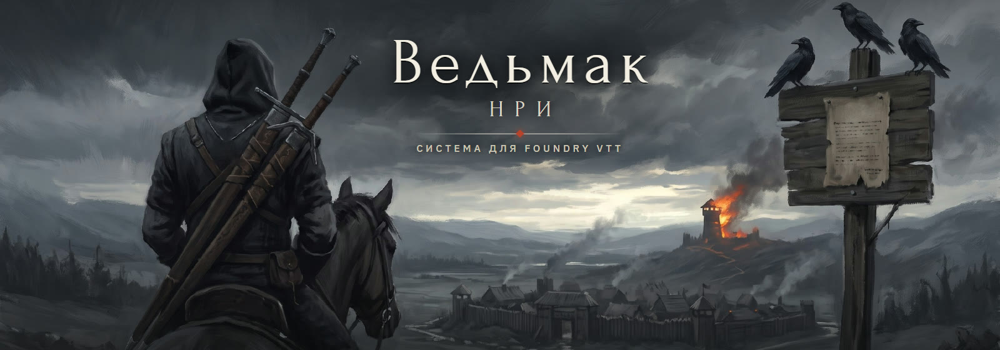
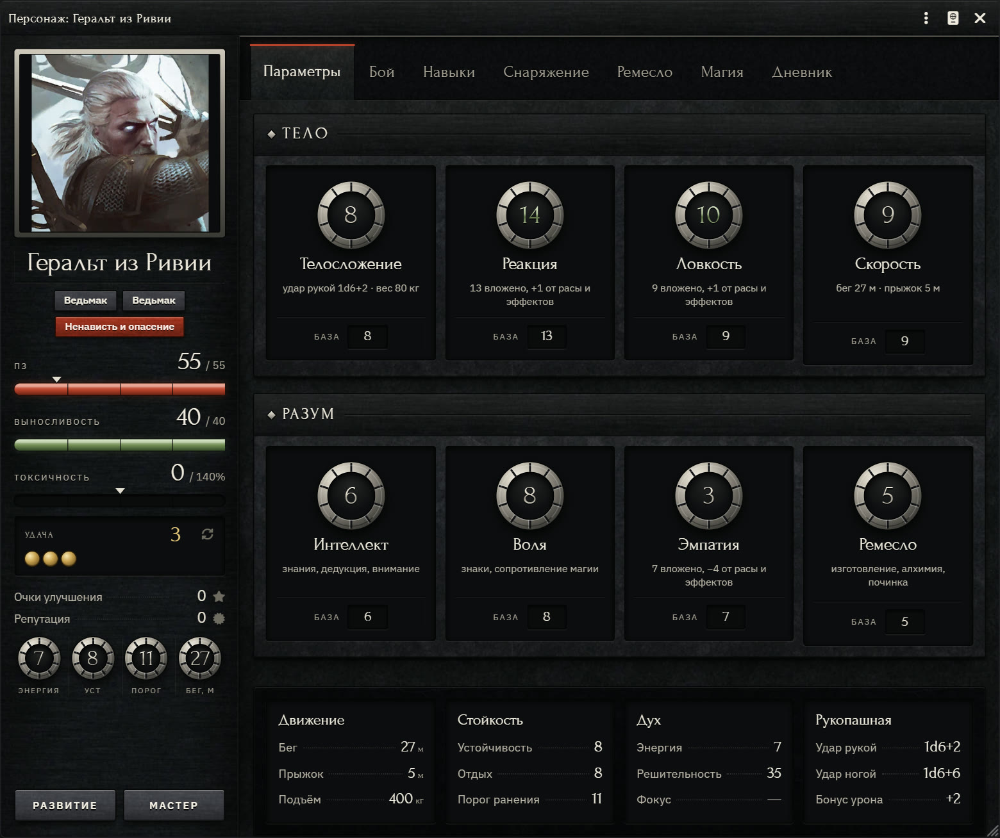
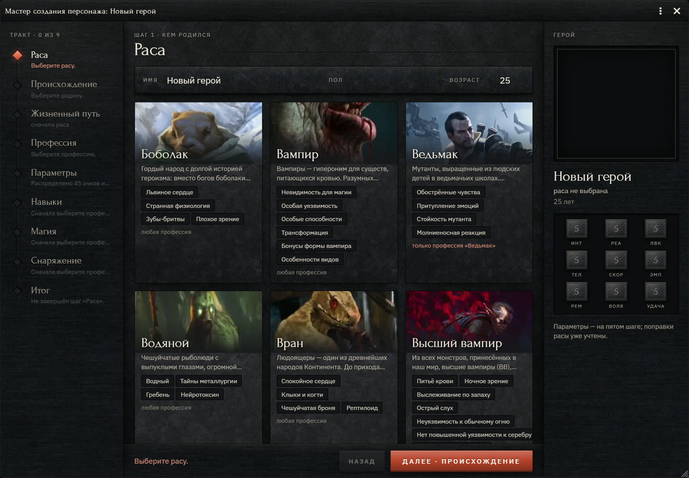
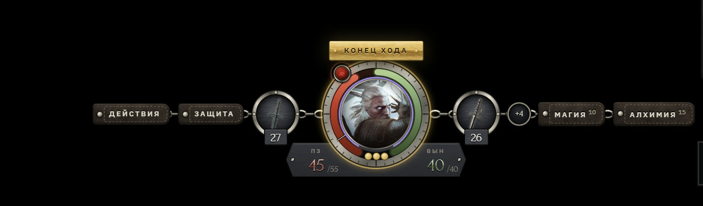
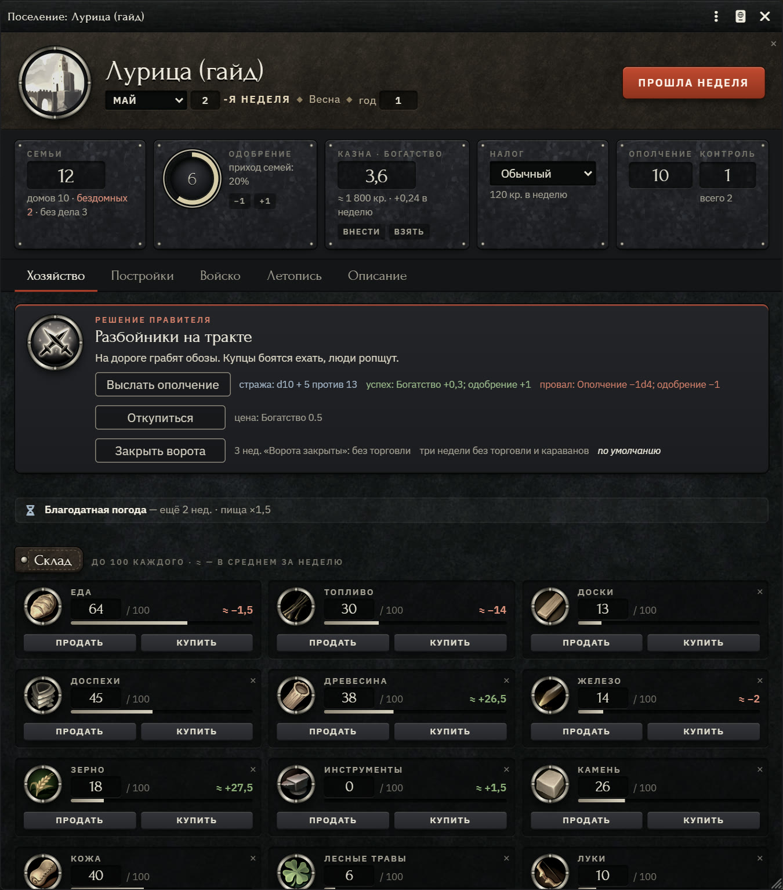
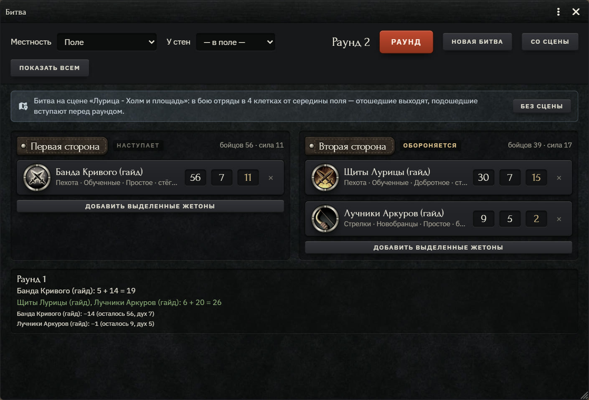
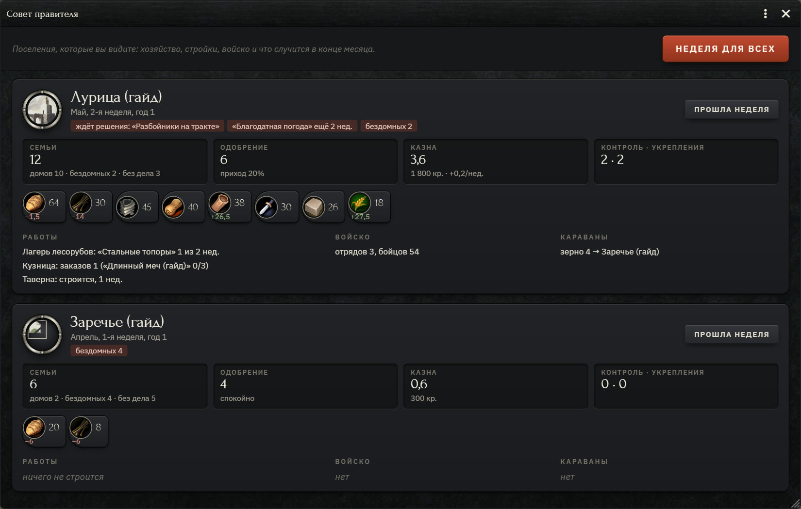

<p align="center">
  
</p>

<p align="center">
  <a href="https://github.com/oralcum61-maker/Vedmak/releases/latest"></a>
  
  <a href="https://github.com/oralcum61-maker/Vedmak/releases"></a>
  
</p>

Неофициальная фанатская система по настольной ролевой игре «Ведьмак» (R. Talsorian Games) для Foundry VTT —
целиком на русском. Некоммерческая: не продаётся и не собирает пожертвований.

## Установка

В Foundry VTT v14 на экране запуска: **Игровые системы → Установить систему** (Game Systems → Install System).
В поле **URL манифеста** (Manifest URL) внизу окна вставьте ссылку и нажмите «Установить»:

```
https://github.com/oralcum61-maker/Vedmak/releases/latest/download/system.json
```

Foundry скачает последнюю версию и сам будет предлагать обновления. Все версии и что в них нового —
на странице [Releases](https://github.com/oralcum61-maker/Vedmak/releases).

## Как это выглядит

<p align="center">
  
  
</p>
<p align="center">
  
</p>
<p align="center">
  
  
  
</p>

## Что внутри

**Персонаж.** Лист в облике «Гравюра»: параметры литыми клеймами, навыки и профессия с деревом способностей,
бой, снаряжение с весом и кошельком в валютах Континента, ремесло и алхимия, магия, дневник. Мастер создания
ведёт героя по тракту из девяти шагов — от расы и жизненного пути до снаряжения.

**Бой.** Атака, защита и урон по корнику — с критическими ранениями, частями тела, бронёй и её прочностью,
состояниями и испытаниями. Боевой худ «Медальон на цепи» держит под рукой действия, защиту, магию и алхимию;
словесная дуэль, верховой бой, анимации и звуки на сцене.

**Магия, ремесло, алхимия.** Знаки, заклинания, инвокации, ритуалы, порчи и тёмные искусства; чертежи и формулы
с субстанциями, усиления, руны и глифы.

**Поселения и войско.** Хозяйство неделя за неделей, постройки с ветками обустройства, управляющие и мастерские,
караваны, события месяца с решениями правителя; отряды с обучением и снаряжением, поход, осада и битва — в окне или
прямо на карте. Подробно — в иллюстрированном гайде
[«Поселения и войско» (PDF)](docs/guide/%D0%9F%D0%BE%D1%81%D0%B5%D0%BB%D0%B5%D0%BD%D0%B8%D1%8F%20%D0%B8%20%D0%B2%D0%BE%D0%B9%D1%81%D0%BA%D0%BE.pdf).

**Для ведущего.** «Нексус» — навигация по сценам вместо полосы Foundry, этажи сцены, пауза-медитация, журнал
расследований, общий стол для битв и игр в таверне.

**Компендиумы — 16.** Магия, расы, профессии, заготовки персонажей, оружие, броня, снаряжение, алхимия, компоненты,
чертежи, усиления; бестиарий на 415 существ и НИП, случайные таблицы, генераторы и памятки по правилам.
Кроме корника — предметное из официальных дополнений: «Снаряжение ведьмака», «Журнал ведьмака», «Фургончик Родольфа»,
«Профессиональные инструменты», «Книга сказаний» и «Том Хаоса». У каждой записи указаны книга и страница —
при игре только по корнику лишнее видно сразу.

Оформление — «Гравюра»: воронёная сталь и выделанная кожа, выпуклые пластины и выбитые клейма, киноварь для атаки
и латунь для Удачи; имена и числа — антиквой Forum, текст — гротеском IBM Plex Sans. Что можно показать символом,
показано символом: кованые части брони, тип урона и хват, знаки стихий и алхимических субстанций; у системы свои
курсоры и синтезированные звуки.

Дорожная карта и состояние работ — [`docs/PLAN.md`](docs/PLAN.md).

## Права

- Правила и тексты — © R. Talsorian Games и правообладатели вселенной «Ведьмак».
- Значки предметов и знаков в `assets/fan/` — материалы игр The Witcher, © CD Projekt RED,
  используются как фанатский контент по правилам CDPR (см. `assets/fan/О-ПРАВАХ.txt`).
  Там же арты рас и профессий и портреты бестиария — карты Гвинта из фанатского компендиума
  BS & Tobi «The Witcher Compendium».
- Бестиарий, случайные таблицы, генераторы и памятки по правилам перенесены из того же
  компендиума BS & Tobi; у записей стоит пометка об этом.
- Жетоны существ в `assets/tokens/` — из компендиума BS & Tobi, среди них наборы 2-Minute Tabletop
  с лицензией только для личного использования (см. `assets/tokens/О-ПРАВАХ.txt`). **В выпуски системы
  они не входят**: сборка `tools/release.mjs` исключает папку, а в бестиарии ставит вместо жетонов портреты.
- Баннеры компендиумов в `assets/banners/` сгенерированы нейросетью Nano Banana Pro (Google) по заказу автора.
  На баннере рас — медальон ведьмака по дизайну CD Projekt RED (фанатский контент).
- Обложка системы (`assets/cover/`, `docs/brand/`) и иллюстрации гайда (`docs/guide/img/`) сгенерированы нейросетью
  по заказу автора; название на обложке наложено шрифтом системы.
- Шрифты Forum и IBM Plex Sans в `fonts/` — SIL Open Font License 1.1.
- Фактуры в `assets/textures/` — из материалов ambientCG, CC0 1.0 (см. `assets/textures/ИСТОЧНИКИ.txt`).
- Звуки в `assets/sounds/` синтезированы для системы (`tools/make-sounds.py`) — свои, их можно раздавать.
